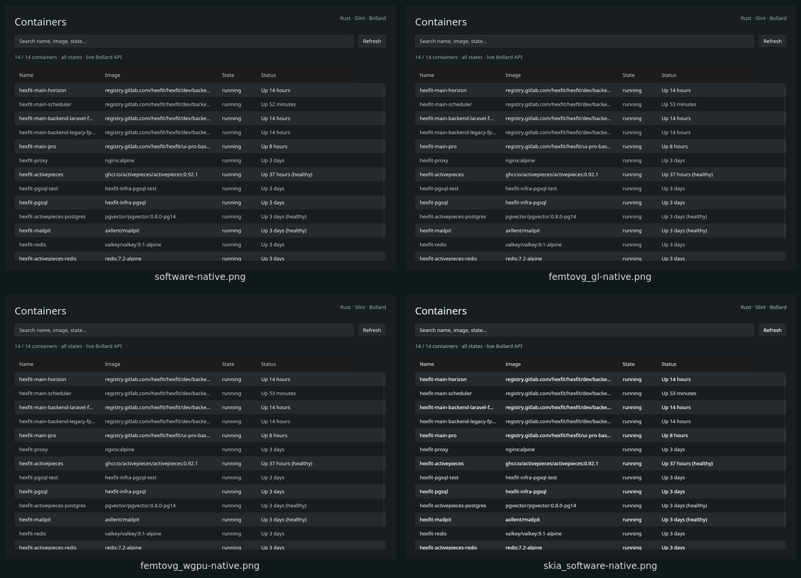

# Docker GUI experiments

Small Docker container-list applications written in **Zig, Go, Rust, C# and TypeScript**, with the
HTML reports, screenshots and measurements collected during an exploratory session
on October 19–November 7, 2026. These are isolated experiments inspired by FerryDock, not a
rewrite or a release of the full application.

The applications show container name, image, state and status, with search and
manual Refresh. There are no container controls or application polling loops.

## Read the reports

**[Read the reports on GitHub Pages](https://pelletiermaxime.github.io/docker-gui-experiments/).**

You can also clone or download this repository and open `index.html` locally.
Each main report is self-contained, with embedded screenshots and downloadable
measurement data. GitHub's repository file viewer displays HTML source; the
Pages site renders it. The `.nojekyll` file preserves the archived report paths
under `.verification/` when publishing the site.

| Experiment | HTML report | Sources |
| --- | --- | --- |
| JSON snapshot / Docker CLI comparison | [Four integrations](.verification/gui-comparison/rapport.html) | [Zig + NanoUI](experiments/nanoui-containers), [Go + MyGo](experiments/mygo-containers), [Rust + GPUI-pre](experiments/gpui-containers), [archived GPUI Kit](.verification/gui-comparison/gpui-kit-baseline) |
| Live Docker client-library comparison | [Eight integrations, one table and screenshot gallery](.verification/gui-live-comparison/rapport.html) | [All live variants](experiments/live-docker) |
| Slint renderer comparison | [Eight configurations](.verification/slint-renderers/rapport.html) | [Same Slint application](experiments/live-docker/slint-renderers) |

MAUI, Avalonia and Native SDK are included in the shared live comparison above. Detailed build
and backend notes remain available in the [MAUI appendix](.verification/maui-live-comparison/rapport.html)
and [Avalonia appendix](.verification/avalonia-live-comparison/rapport.html).

The [Native SDK port](experiments/live-docker/native-sdk/README.md) uses compiled
TypeScript for its UI and SDK-managed native service, plus a native Go worker
using the official Moby SDK. Node is a build tool only. Its size includes all
three native executables; idle resources include the persistent service host.

The first report includes executable size, source lines, code-quality discussion,
memory, CPU and observed compilation timings. The live report compares Docker SDK integrations, with dated results below the
historical NanoUI, MyGo and GPUI measurements, plus Rune's production result. The renderer report
holds the Slint application constant while changing its rendering configuration.

## Implementations

| Language | UI | Data source / Docker client |
| --- | --- | --- |
| Zig | NanoUI | Docker CLI / NDJSON snapshot |
| Go | MyGo | Docker CLI / NDJSON snapshot |
| Rust | GPUI-pre 0.3.9 | Docker CLI / NDJSON snapshot |
| Rust | GPUI Kit 0.8.0 / GPUI Fast | Archived snapshot/CLI baseline |
| Zig | NanoUI 0.12.0 | Zig Docker SDK |
| Go | MyGo 0.8.1 | Official Moby client |
| Rust | GPUI-pre 0.3.11 | Bollard |
| Rust | Rune f73f72c / wgpu | Bollard |
| Rust | Slint 1.18.1 | Bollard |
| C# | .NET MAUI 10 / experimental GTK4 Linux backend | Docker.DotNet.Enhanced 4.3.3 |
| C# | Avalonia 12.1.2 / desktop Skia | Docker.DotNet.Enhanced 4.3.3 |
| TypeScript | Native SDK 0.11.0 / compiled native UI | Compiled TypeScript service + native Moby Go SDK worker v0.6.2 |

Slint configurations: its software renderer, FemtoVG/OpenGL, FemtoVG/WGPU,
Skia/software, Skia/OpenGL, Skia/WGPU, experimental Vello, and the Qt backend.



## Build and reproduce

1. Read the chosen application's README for build flags and platform requirements.
2. Restore the three pinned Git dependencies used by the Zig and Go variants:
   `python3 scripts/bootstrap-deps.py`. This downloads NanoUI, MyGo, container-zig
   into ignored directories and applies the archived Zig SDK compatibility patch.
3. Install the corresponding compiler/toolchain. The recorded session used Zig
   0.17.0, Go 1.27.1 and Rust 1.99.0. Cargo and Go lock/checksum files are included.
   The November 7 refresh uses Go 1.27.3 with the same Zig/Rust versions.
   The original Zig README includes the recorded toolchain download/checksum.
4. Build and launch using the individual READMEs. Interpret "FerryDock root" in
   the preserved instructions as **this repository's root**. Local dependency
   paths are intentionally preserved so these commands keep the same layout.

Examples of source directories:

- `experiments/nanoui-containers`, `experiments/mygo-containers`,
  `experiments/gpui-containers`: original snapshot/CLI apps.
- `experiments/live-docker/*-containers`: independent live Docker variants.
- `experiments/live-docker/slint-renderers`: feature-selected renderer builds.

The live applications need a running, accessible Docker Engine. Set `DOCKER_HOST`
explicitly for a non-default endpoint; transport and TLS capabilities differ
between SDKs. This archive does not add Docker context discovery to the apps.
The snapshot applications can instead use the included NDJSON fixture via
`CONTAINER_SNAPSHOT`.

The primary Linux stacks require their system graphics/windowing libraries.
NanoUI uses GTK with CPU or OpenGL drawing depending on the version and renderer
selection; MyGo uses its GTK/OpenGL backend; GPUI and Rune use wgpu/Vulkan.
Slint variants have renderer-specific requirements. System packages and toolchains are not
installed by the bootstrap script.

The archived GPUI Kit README predates its relocation. To build that specific
integration, use its actual archived manifest rather than the primary GPUI-pre
manifest:

```sh
CARGO_TARGET_DIR="$PWD/.verification/gui-comparison/gpui-kit-baseline/target" \
  CARGO_BUILD_JOBS=4 cargo build --release --locked \
  --manifest-path .verification/gui-comparison/gpui-kit-baseline/Cargo.toml
CONTAINER_SNAPSHOT="$PWD/.verification/gui-comparison/containers.ndjson" \
  .verification/gui-comparison/gpui-kit-baseline/target/release/gpui-containers
```

Measurement scripts are in `experiments/measure.py`,
`experiments/live-docker/measure.py` and `.verification/slint-renderers/`.
They use Linux `/proc`, X11/XWayland and desktop tools such as `xdotool`,
ImageMagick, and (for some observation scripts) `strace` and Tesseract.
The November 7 native Wayland workflow is documented in
[the live comparison README](experiments/live-docker/README.md#november-7-production-refresh):
`prepare-latest.sh` fetches the current toolkit pins, `benchmark.py` runs three
clean production builds, and `verify_wayland.py` checks native input and samples
idle resources. Dependencies are fetched before timing; build caches are isolated;
four build jobs are used. Rust uses opt-level=3, fat LTO and stripping.
The dated results use COSMIC and native Wayland; earlier results retain their
original backends and profiles. The rendering column identifies CPU/GPU and backend.

These harnesses are Linux-specific even when the application libraries support
other platforms. Report-generation scripts may expect rebuilt binaries at their
recorded paths; pre-generated HTML and JSON can be read without rebuilding.

## What the numbers establish

- The main resource runs use a 1,000 × 680 client surface at scale 1, a four-second
  warmup, and twenty seconds at idle, generally with three runs per configuration.
- The later Avalonia and Native SDK experiments use a deliberately shortened protocol at the
  user's request: **one run, two seconds warmup and five seconds idle**. They have
  more uncertainty and is labeled separately from the older three-run results.
- Memory is process RSS/PSS, not full system/compositor or GPU memory. Executable
  sizes exclude shared libraries and drivers; the Qt build also excludes system Qt.
- Source counts use the documented scope. The GPUI app includes its local text
  input implementation, and Slint includes its inline UI declarations.
- Historical compilation observations include cache reuse. The dated NanoUI,
  MyGo, GPUI and Rune results include three clean production builds, with medians
  and ranges. Filesystem caches are not flushed.
- The November 7 production binaries passed native Wayland inventory matching,
  search, clearing, no results, Refresh, retained data after HTTP failure, a
  responsive ten-second timeout and recovery. NanoUI and GPUI use F5 for Refresh;
  MyGo and Rune use native button actions. Active throughput is not measured.
- The comparisons use the recorded pins and configurations. They do not measure the
  full current FerryDock application or prove a general toolkit/language ranking.
- Windows/macOS discussion is based on upstream capabilities; these apps were
  observed on Linux only. The current native verification drivers run separately
  from resource sampling.

The original limitations, failed attempts and corrections remain in the reports.
In particular, the corrected Skia/OpenGL measurements replaced runs that silently
fell back to another renderer; those excluded runs remain in their archive.

## Archive contents and provenance

`experiments/` and the original three `.verification/` report directories were copied from
the working session. Later experiments are added directly to this repository.
[ARCHIVE-MANIFEST.json](ARCHIVE-MANIFEST.json) records current SHA-256 hashes;
`original_sha256` retains initial-copy hashes for files subsequently updated.
The November 7 evidence is under `.verification/wayland-refresh-20261107/`.
Sources, earlier baselines, reports, raw data,
screenshots, build logs, traces, patches and report generators are retained.
Historical paths, inventory labels and statements such as "no commit or push"
describe the original measurement session, before this archive was published.

Downloaded dependency checkouts, compiler toolchains, caches and executable
binaries are excluded. No FerryDock Git history or unrelated application sources
are included. Earlier baselines and build-timing source copies are archival
evidence; use the primary `experiments/` folders for the current versions.

## Licensing

Original experiment code is under the included [MIT license](LICENSE). The GPUI
search implementations derive from Zed's Apache-2.0 input example; their
`LICENSE-APACHE` files are retained. External dependencies retain their own
licenses, including Slint's licensing terms; the experiment's MIT license does not
relicense them. Dependency source trees are fetched separately rather than vendored.
